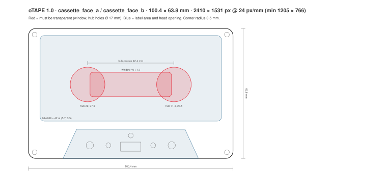
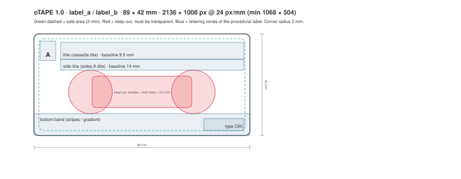
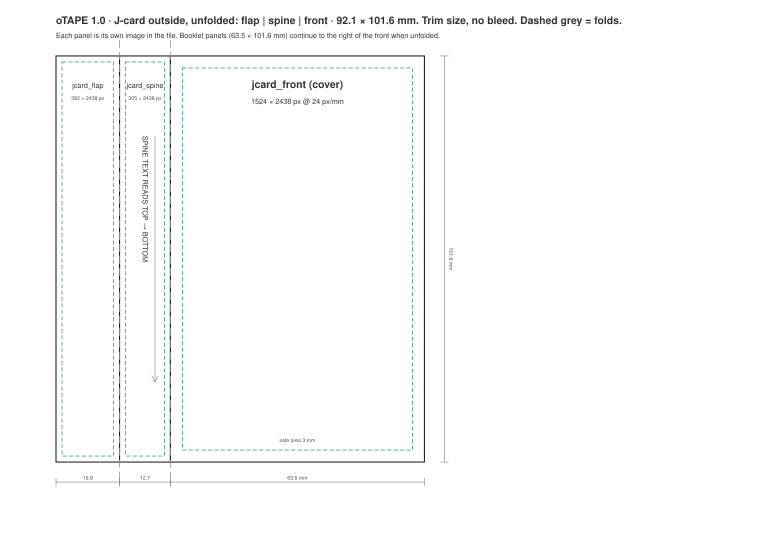

# oTAPE: the open digital cassette format

**oTAPE** (`.otape`) stores one cassette in one file: two sides of continuous audio, the cassette's look, its
J-card and booklet, record tabs, track markers and history. It preserves the experience of owning, recording,
flipping, protecting and playing a cassette, not just the audio.

oTAPE is an open specification by **Jan Osio**. Anyone may implement it, in free or commercial software,
without royalties or permission.

> A cassette is not just audio. It is audio, sides, artwork, packaging, protection and memory.

**Current version: 1.0** (release candidate, 2026-10-29) · [Read the specification →](oTAPE-1.0.md)

---

## At a glance

```
my-mixtape.otape                ZIP container
├── mimetype                    "application/vnd.otape.cassette", first entry, stored
├── manifest.json               cassette identity, sides A/B, appearance, J-card, artwork, history
├── audio/side-a.m4a            AAC-LC, one continuous recording per side
├── audio/side-b.m4a            (absent while a side is blank)
├── artwork/…                   optional images in fixed physical proportions
└── docs/…                      optional booklet.html and notes.md
```

| | |
| --- | --- |
| Extension | `.otape` |
| Media type | `application/vnd.otape.cassette` |
| Apple UTI | `org.otape.cassette` |
| Cassette types | C46, C60, C90, C120, custom (up to 90 min per side) |
| Audio | AAC-LC in M4A (required); ALAC, FLAC, PCM optional |
| Timeline | integer frames at 44 100 or 48 000 Hz |
| Record tabs | `intact` → `broken` → `taped_over` per side, simulation not DRM |

### Artwork sizes

Physical trim size, no bleed. Recommended 24 px/mm, minimum 12 px/mm, aspect within ±1 %.

| Slot | mm | Recommended px | Minimum px |
| --- | --- | --- | --- |
| Cassette face A / B | 100.4 × 63.8 | 2410 × 1531 | 1205 × 766 |
| Label A / B | 89.0 × 42.0 | 2136 × 1008 | 1068 × 504 |
| J-card front | 63.5 × 101.6 | 1524 × 2438 | 762 × 1219 |
| J-card spine | 12.7 × 101.6 | 305 × 2438 | 152 × 1219 |
| J-card back flap | 15.9 × 101.6 | 382 × 2438 | 191 × 1219 |
| Booklet panel | 63.5 × 101.6 | 1524 × 2438 | 762 × 1219 |
| Thumbnail | square | 1024 × 1024 | 256 × 256 |

Shell and label images must stay transparent over the window and hub holes so the player's animated reels show
through. See the [templates](templates/).

| Cassette face | Label | J-card (flap · spine · front) |
| --- | --- | --- |
|  |  |  |

---

## Repository

| Path | Contents |
| --- | --- |
| [`oTAPE-1.0.md`](oTAPE-1.0.md) | **The specification** (normative) |
| [`schema/`](schema/) | JSON Schema (draft 2020-12) for `manifest.json` |
| [`geometry/`](geometry/) | Machine-readable geometry: every dimension of the spec as JSON |
| [`templates/`](templates/) | SVG artwork templates, 1:1 in millimetres |
| [`examples/manifests/`](examples/manifests/) | Example manifests. `invalid-*` must be rejected by a conforming reader. |
| [`examples/files/`](examples/files/) | Complete example cassettes (`.otape`) |
| [`tools/`](tools/) | Validator, template and example generators, self-test (Python 3, standard library) |
| [`CHANGELOG.md`](CHANGELOG.md) | Version history |
| [`CONTRIBUTING.md`](CONTRIBUTING.md) | How to propose changes |

## Validate a cassette

```bash
pip install -r tools/requirements.txt          # optional: enables the JSON Schema check
python3 tools/otape_validate.py my-mixtape.otape
```

```
VALID   my-mixtape.otape
```

The validator checks the ZIP container, the `mimetype` entry, safe paths, the manifest (schema plus the
cross-field rules of §16.1), artwork proportions and resolution, and the HTML booklet profile. It also accepts
a bare `manifest.json`. Exit status: 0 valid, 1 invalid.

## Implementing oTAPE

A minimal player needs about a page of code:

1. Open the ZIP and read `manifest.json`. Check `format == "oTAPE"` and that the major version is `1`.
2. For each side `A` and `B`: if `audio` is not `null`, decode `audio.file` and treat it as exactly
   `recorded_frames` long. The rest of the side, up to `side_length_seconds`, is blank tape (silence).
3. Play from the head position. Wind with FF/REW instead of jumping. Flipping maps position *p* to *L − p*.
4. Draw the cassette from `appearance`, or from `artwork` images where present.
5. Remember the head position per `cassette.id` locally. **Playing never modifies the file.**

A recorder also overwrites in place, keeps `recorded_frames` as a high-water mark, respects `broken` record
tabs, and preserves fields and files it doesn't understand. [§16](oTAPE-1.0.md#16-conformance) lists every
requirement. [`tools/make_examples.py`](tools/make_examples.py) is a short, readable reference writer.

## Implementations

| Name | Platform | Role |
| --- | --- | --- |
| [oTape Studio](https://github.com/otape-studio/otape-studio) | macOS 14+ | Reference recorder and player, by Jan Osio |

Building something with oTAPE? Open a pull request to add it here.

## Maintenance

```bash
python3 tools/selftest.py          # schema, examples and templates are consistent (CI runs this)
python3 tools/make_templates.py    # after editing geometry/otape-geometry-1.0.json
python3 tools/make_examples.py     # rebuild examples/files (needs afconvert or ffmpeg)
```

## Licence

© 2026 Jan Osio. Everything in this repository (specification, schema, geometry, templates, examples and
tools) is licensed under [CC BY 4.0](https://creativecommons.org/licenses/by/4.0/). Credit *"oTAPE
specification by Jan Osio"* when you copy or adapt it. Implementing the format needs no licence at all. See
[LICENSE.md](LICENSE.md).
